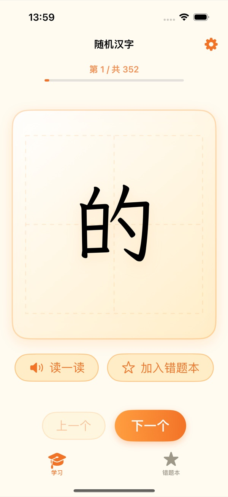
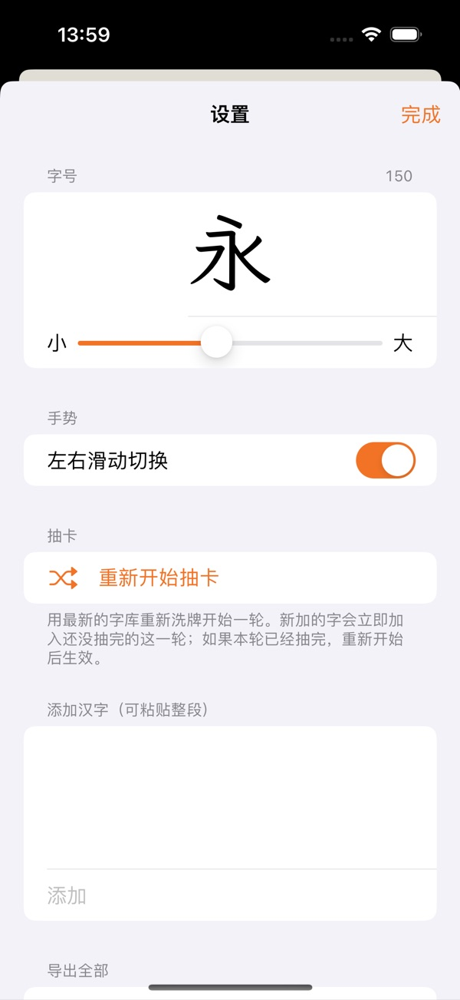
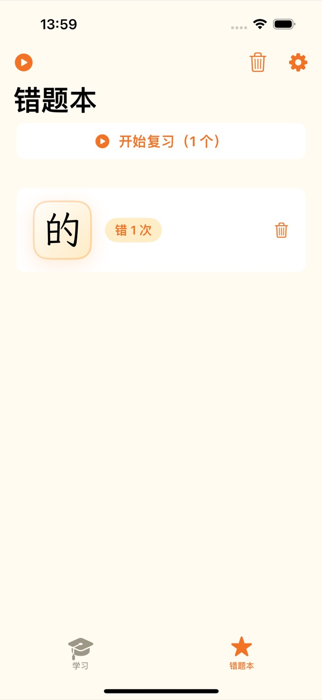
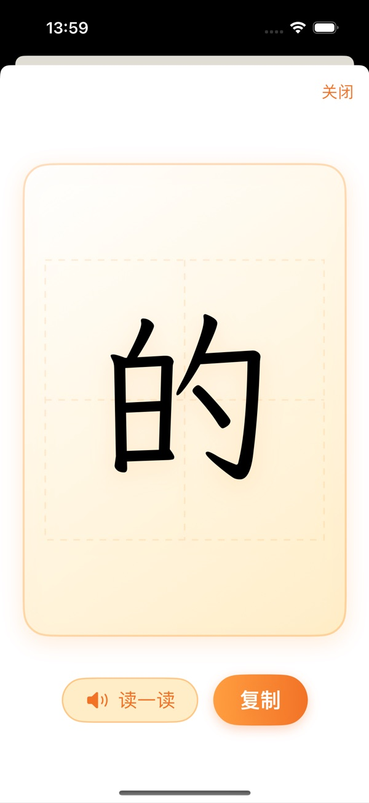
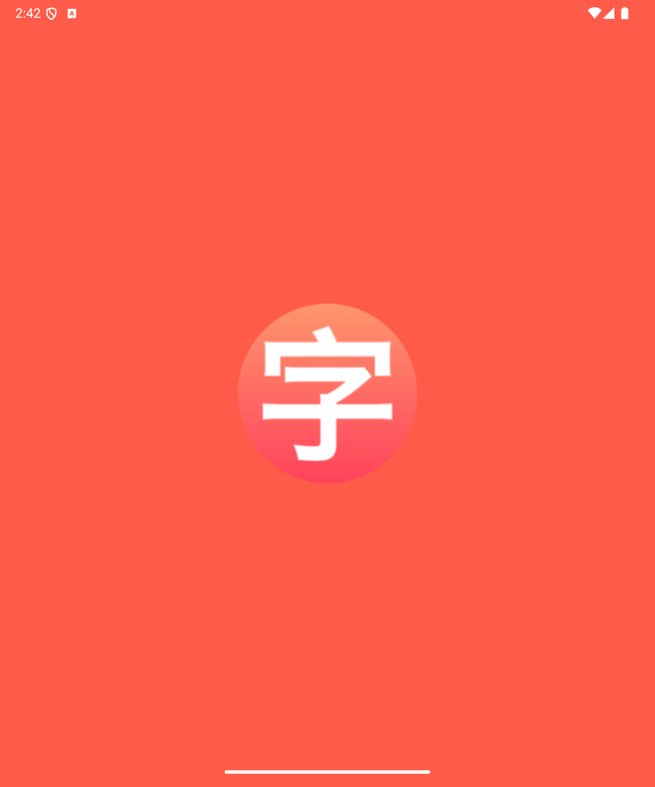
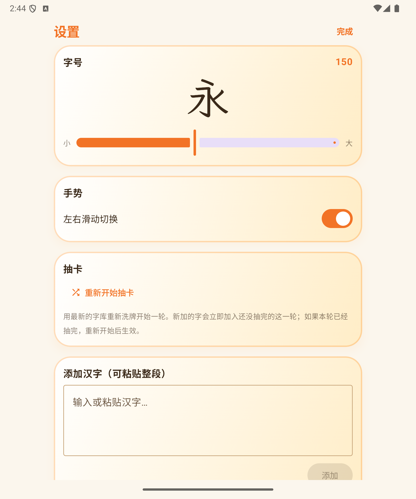
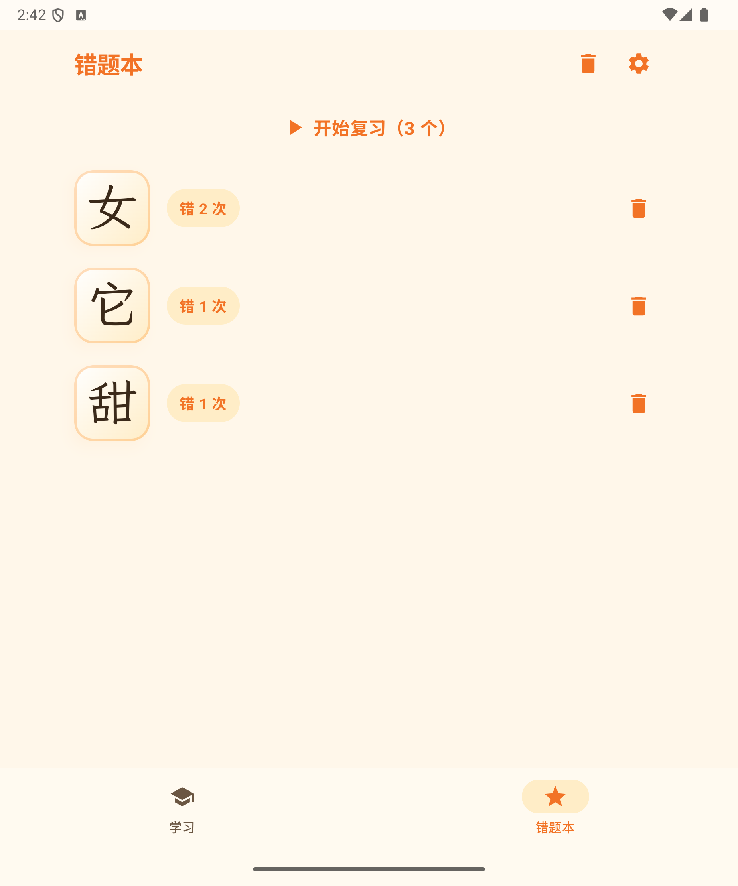
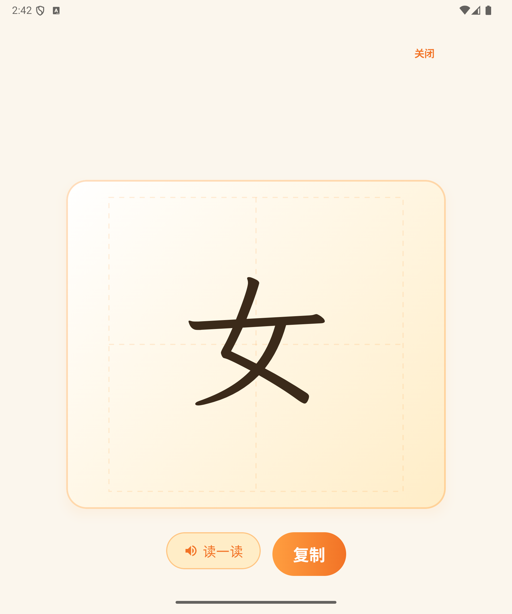

# 随机汉字 HanziRandom

一个用于识字练习的 iOS App：从字库中随机抽字展示，配合正楷大字、田字格、朗读和错题本，一轮内不重复。

<table>
  <tr>
    <td></td>
    <td></td>
  </tr>
  <tr>
    <td></td>
    <td></td>
  </tr>
</table>

## 功能

- **随机抽字**：一轮内不重复展示，抽完提示；支持「上一个 / 下一个」和左右滑动
- **正楷展示**：内嵌霞鹜文楷 GB Lite，田字格背景，字号 60–260 可调并实时预览
- **朗读**：点击大字或「读一读」，使用系统中文语音（zh-CN）朗读
- **字库管理**：粘贴整段文字批量添加（自动过滤非汉字、去重）、删除、复制、导出分享
- **错题本**：记录错字次数并排序，支持按错题复习；复习中可直接删除错题，清空前有确认
- **本地持久化**：字库、错题、当前轮次进度、字号与手势偏好均保存在本机，全程无网络请求
- **iPad 适配**：内容栏限宽居中，横竖屏均可用

## 环境要求

- iOS 16.0+
- Xcode 26（使用 iOS 模拟器或真机运行）
- [XcodeGen](https://github.com/yonaskolb/XcodeGen)：`brew install xcodegen`

## 构建

`HanziRandom.xcodeproj` 和 `Info.plist` 由 `project.yml` 生成，不纳入版本管理：

```bash
brew install xcodegen
xcodegen generate
open HanziRandom.xcodeproj
```

命令行构建：

```bash
xcodebuild -project HanziRandom.xcodeproj -scheme HanziRandom \
  -destination 'platform=iOS Simulator,name=iPhone 15 Pro' build
```

## 测试

```bash
xcodebuild test -project HanziRandom.xcodeproj -scheme HanziRandom \
  -destination 'platform=iOS Simulator,name=iPhone 15 Pro'
```

- `Tests/`：`CharacterStore` 的增删改查与持久化、`DrawSession` 的抽卡逻辑、朗读服务的音频会话配置
- `UITests/`：学习页导航、错题本、详情页、复习模式和清空确认

## 项目结构

```
Sources/
  HanziRandomApp.swift      应用入口，前后台轮次保存
  RootTabView.swift         学习 / 错题本两个 Tab
  StudyView.swift           抽字主界面（学习与复习共用）
  MistakeBookView.swift     错题本
  CharacterDetailView.swift 汉字详情（朗读、复制）
  ManageView.swift          设置与字库管理
  CharacterStore.swift      字库、错题与轮次持久化
  DrawSession.swift         单轮抽卡状态机
  SpeechService.swift       AVSpeechSynthesizer 封装
  Theme.swift               配色、按钮样式、田字格
  Assets.xcassets/          App 图标与启动页资源
  Resources/Fonts/          内嵌字体及授权
Tests/                      单元测试
UITests/                    UI 测试
docs/                       设计文档
project.yml                 XcodeGen 配置（工程唯一来源）
```

## 字体

界面中的汉字使用 [霞鹜文楷 GB Lite（LXGW WenKai GB Lite）](https://github.com/lxgw/LxgwWenKai)，遵循 SIL Open Font License 1.1，授权文本见 `Sources/Resources/Fonts/OFL.txt`。

字体随 App 内嵌，是因为 iOS 系统运行时（包括模拟器）没有楷体字体，直接使用 `Kaiti SC` 会静默回退成黑体。

## 设计文档

实现细节与需求约定见 [设计文档](docs/superpowers/specs/2026-10-15-random-hanzi-app-design.md)。

## Android 版

Android 版位于 `android/`，与 iOS 版功能对齐（Kotlin + Jetpack Compose）。

<table>
  <tr>
    <td></td>
    <td></td>
  </tr>
  <tr>
    <td></td>
    <td></td>
  </tr>
</table>

### 环境要求

- JDK 17（AGP 要求）：`brew install --cask temurin@17`
- Android SDK Platform 35
- 模拟器或真机（Android 8.0 / API 26+）

### 构建与安装

```bash
cd android
JAVA_HOME=$(/usr/libexec/java_home -v 17) ./gradlew assembleDebug
JAVA_HOME=$(/usr/libexec/java_home -v 17) ./gradlew installDebug
```

### 测试

```bash
cd android
JAVA_HOME=$(/usr/libexec/java_home -v 17) ./gradlew testDebugUnitTest
JAVA_HOME=$(/usr/libexec/java_home -v 17) ./gradlew connectedDebugAndroidTest
```

### 结构

```
android/app/src/main/java/com/liuli/hanzirandom/
  MainActivity.kt            单 Activity 入口
  HanziApplication.kt        仓库、朗读、后台轮次保存
  data/                      KeyValueStore、字库/错题/设置仓库
  domain/                    DrawSession 状态机、TextToSpeech 封装
  ui/                        Compose 页面、ViewModel、主题与组件
android/app/src/main/res/font/
  lxgw_wenkai_gb_lite_regular.ttf   内嵌正楷字体
```

Android 版同样内嵌霞鹜文楷字体，不申请任何权限，全程无网络请求。

设计文档见 [docs/superpowers/specs/2026-10-19-android-port-design.md](docs/superpowers/specs/2026-10-19-android-port-design.md)。
